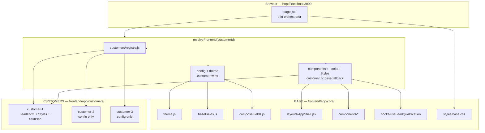
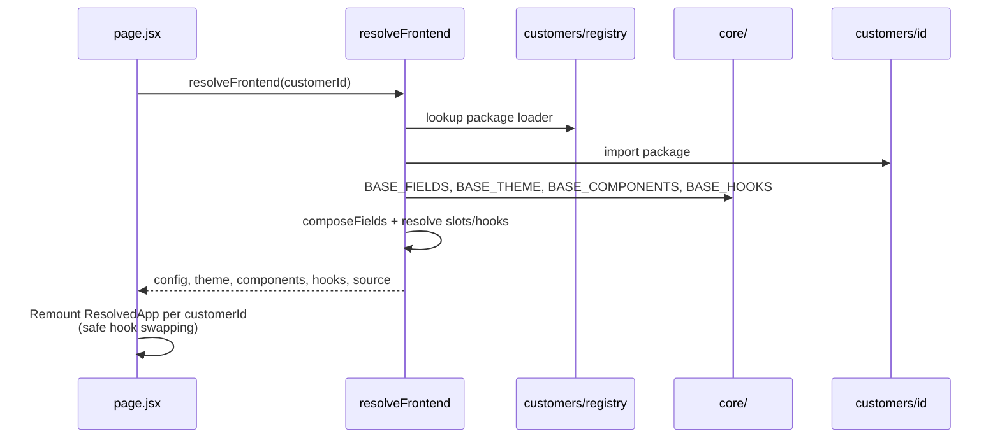
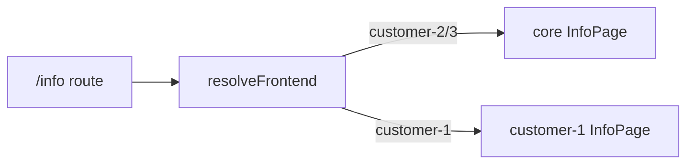

# Frontend Architecture — Base-First with Customer Override

> Companion guide for the Customer Architecture POC frontend.  
> Main runbook: [README.md](./README.md)

This document explains how the **complete base frontend** is shared by all customers, and how **customer-specific overrides** take precedence without forking or duplicating the whole app.

---

## 1. Goals

| Principle | Meaning in this POC |
|---|---|
| **Base-first** | `frontend/app/core/` owns the full default UI (layout, components, hooks, theme, fields, CSS). |
| **Customer override** | Customer `components` / `hooks` / `styles` / `fieldPlan` always win over base. |
| **Fallback** | Missing customer pieces automatically use base. |
| **Extensible** | New customer = new folder + **one line** in `customers/registry.js` (not core UI). |
| **Portable** | Base UI does not import customer components; only the registry is referenced. |
| **Maintainable** | Customers compose base building blocks (`LeadFormFields`, `LeadFormFooter`) instead of copying markup. |
| **Clear separation** | Product in `core/`; deltas in `customers/<id>/`. |

---

## 2. High-level architecture



---

## 3. Folder map

```text
frontend/app/
├── page.jsx                         # Thin orchestrator
├── globals.css                      # @imports core/styles/base.css
├── layout.js                        # Minimal document shell
│
├── core/                            # ★ COMPLETE BASE FRONTEND
│   ├── resolveFrontend.js           # Merge engine (reads registry)
│   ├── theme.js / baseFields.js / composeFields.js / formUtils.js
│   ├── styles/base.css
│   ├── hooks/useLeadQualification.js
│   ├── layouts/AppShell.jsx
│   └── components/
│       ├── LeadForm.jsx             # + LeadFormFields / LeadFormFooter exports
│       ├── FieldRow.jsx · Hero.jsx · CustomerPanel.jsx · LeadList.jsx
│       ├── ArchitecturePanel.jsx · Styles.jsx (noop)
│
└── customers/                       # ★ OVERRIDES + REGISTRY
    ├── registry.js                  # ★ Only registration point for new customers
    ├── README.md
    ├── customer-1/
    │   ├── index.js                 # config + components + hooks maps
    │   ├── config.js
    │   ├── components/LeadForm.jsx  # composes base fields/footer
    │   ├── components/Styles.jsx    # imports customer CSS
    │   └── styles/overrides.css
    ├── customer-2/                  # config only → full base fallback
    └── customer-3/                  # config only → full base fallback
```

---

## 4. Runtime resolution



### Preference order

```text
1. Customer package (config / components / hooks / Styles)
2. Base core (fallback)
```

### Overridable slots

| Kind | Slots |
|---|---|
| Components | `AppShell`, `Hero`, `CustomerPanel`, `LeadForm`, `LeadList`, `ArchitecturePanel`, `FieldRow`, `Styles` |
| Hooks | `useLeadQualification` |

---

## 5. Per-customer behaviour in this POC

| Customer | AppShell (layout) | Hook | LeadForm | Styles | InfoPage | BrandIcon |
|---|---|---|---|---|---|---|
| customer-1 | **Override** | **Override** `useLeadQualification` | **Override** | **Override** | **Override** | **Override** |
| customer-2 | Base | Base | Base | Base | Base | Base |
| customer-3 | Base | Base | Base | Base | Base | Base |

### Customer-1 hook + layout examples

```text
customers/customer-1/
├── hooks/useLeadQualification.js   # wraps base hook; prefills solar defaults
└── layouts/AppShell.jsx            # same slots, adds GreenGrid ribbon + footer
```

Registered in `customers/customer-1/index.js`:

```js
export const components = {
  AppShell: () => import("./layouts/AppShell"),
  // ...
};

export const hooks = {
  useLeadQualification: () => import("./hooks/useLeadQualification"),
};
```

### Adding another HTML/UI page (pattern)

1. Create **base** page component: `core/components/YourPage.jsx`
2. Add `"YourPage"` to `COMPONENT_SLOTS` + `BASE_COMPONENTS`
3. Add Next route: `app/your-route/page.jsx` that renders resolved `YourPage`
4. For customer-1 only: add `customers/customer-1/components/YourPage.jsx` and register in `components` map

Example already in this POC:

| Route | Base page | Customer-1 page |
|---|---|---|
| `/` | Lead form slots | LeadForm override |
| `/info` | `core/components/InfoPage.jsx` | `customers/customer-1/components/InfoPage.jsx` |



---

## 6. Config merge (`fieldPlan`)

| Need | How |
|---|---|
| Reorder | `fieldPlan.order` |
| Override base field | `fieldPlan.overrides` (customer keys win) |
| Clear base style | `style: null` |
| Add fields | `fieldPlan.extras` |
| Theme / page class | `accent`, `pageStyle`, `pageClassName` |

---

## 7. How to add customer-4

1. Create `frontend/app/customers/customer-4/` with `config.js` + `index.js`
2. Add one line to **`frontend/app/customers/registry.js`**
3. Optionally add `components/`, `styles/`, `hooks/`
4. Rebuild frontend

```js
// customers/registry.js
export const CUSTOMER_PACKAGES = {
  "customer-1": () => import("./customer-1"),
  "customer-2": () => import("./customer-2"),
  "customer-3": () => import("./customer-3"),
  "customer-4": () => import("./customer-4"), // ← only change in registry
};
```

Do **not** edit `core/components` or `core/layouts` for customer-only behaviour.

---

## 8. Compliance checklist (post-hardening)

| Requirement | Status |
|---|---|
| Base = complete common frontend | Yes — components, layout, hooks, fields, theme, base CSS |
| Customers inherit base | Yes — empty `components`/`hooks` → full base |
| Customer always wins | Yes — config, fields, component slots, hooks, Styles |
| Override without modifying base UI | Yes — registry lives under `customers/` |
| Avoid duplicating frontend | Yes — customer-1 composes `LeadFormFields` / `LeadFormFooter` |
| CSS layered | Yes — `core/styles/base.css` + customer `Styles` slot |
| Hooks overridable | Yes — `hooks` map with remount-safe usage in `page.jsx` |
| Extensible / portable | Yes — new customer = folder + registry line |

---

## 9. Tests

```bash
cd frontend && npm test
```

Covers composeFields precedence, registry location, customer-1 LeadForm/Styles overrides, and base fallback for customer-2/3.

---

## 10. Demo checklist

1. http://localhost:3000/
2. **customer-1** — yellow Name, red/green split form, customer CSS class `theme-customer-1`
3. **customer-2** — base LeadForm + consent fields; Name stays base blue
4. **customer-3** — pure base form
